--- 
title: "Day 10: Dusseldorf"
categories: [mannheim2026]
tour: [ mannheim2026 ]
distance: 151
time: 7h17m
gpx: /gpx/mannheim2026/dussel.gpx
bundle_image: 202610112016-cathedral3.jpg
date: 2026-10-12
#fediverse: 117389960673430024
---

It's 19:30 in my hotel room. The hotel room wouldn't have looked any different
in 1974 except the the flat-screen TV. There is an clock-radio built into the
wood pannelling. The radio doesn't work and it seems neither does the
clock[^itseems]. I have the pizza and the beers and some chocolate. It's not
a great pizza and the beers aren't great beers. The chocolate I haven't tried
yet.

---

I didn't sleep well last night, somehow I remember counting the number of
times I woke up as five finally waking up later than I would have liked and
got the lift down to the ground floor the the €14 breakfast "pay in the
restaurant" said the reception "pay at reception" said the restaurant. I went
back up but the key wouldn't work. So back down the lift I went but had to
join a queue in reception.

There was a three-way conversaion happening between a Spanish guest, a random
member of staff who could understand Spanish and the Receptionist. The member
of staff was explaining something to the Spanish lady but I couldn't recognise
what he was saying as Spanish, he had a very strong accent and it sounded more
like Portuguese. "Hablo Espanol?" she asked at the first additional member of
staff that appeared briefly. The man behind me decided to take the situation
into his own hands "Diga mi" he
said confidently to the lady who proceeded to explain. The man was Italian and
didn't speak German so that ended there. Finally the receptionist gave me his
attention and didn't look surprised at all that my key didn't work and
promptly re-activated my key.

Being allowed back into my room I proceeded to pack my stuff - wanting to get
away by 9:00am - but I smelt something. I had smelt something while unpacking
the night before but couldn't figure out what it was - it wasn't a strong
smell. I checked my shoe - a big clod of shit acting as squished up glue for
all manner of forest refuse. I spent the next 10 minutes cleaning the shoe and
left at 09:30am.

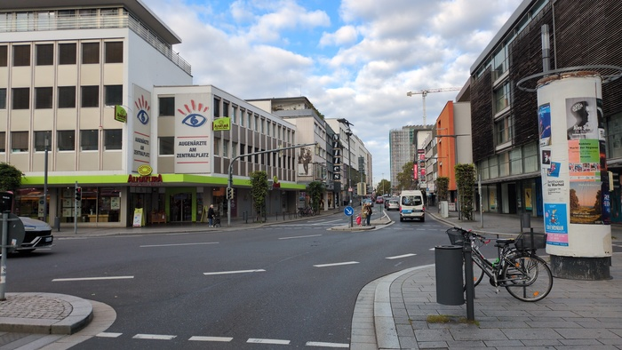
_Riding through Koblenz_

I descended the big hill with the spectacular view and it was colder than it
has been so far requiring both gloves and the neck-gaiter under the helmet.
The headache was returned, simmering on a low-level. I rode into Koblenz with
the Pendler and rode out without them.

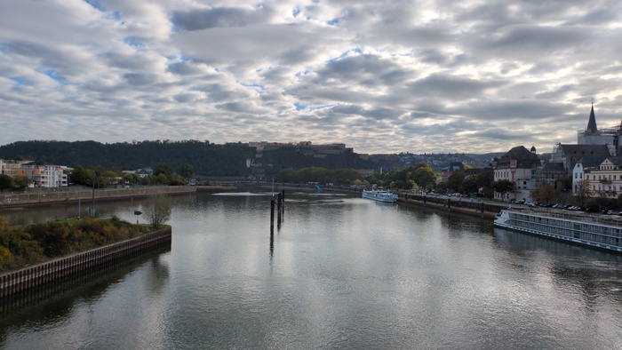
_Leaving Koblenz - some Fort in center-view_

The surrounding terrain falttened out after Koblenz for a period and I was
again riding the cycle paths alongside the Rhine. 

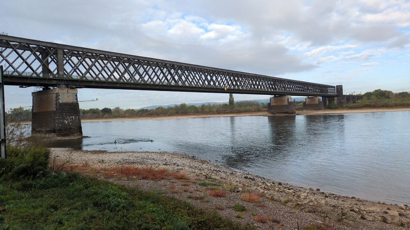
_It hadn't been raining_

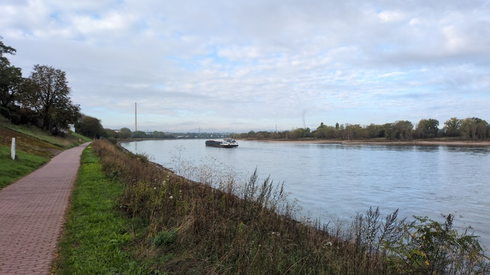
_It did not rain_

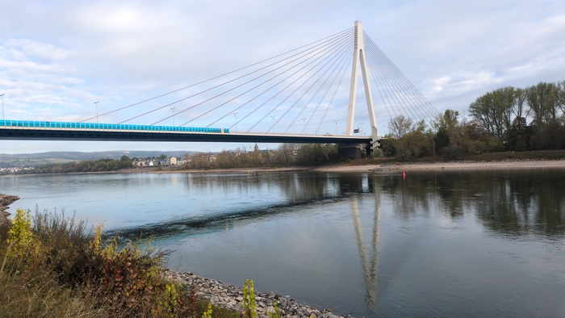
_Occasionally there are bridges_

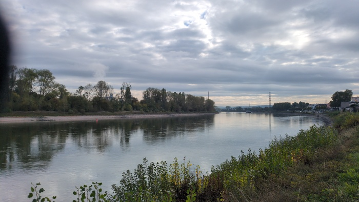
_There are a number of trees_

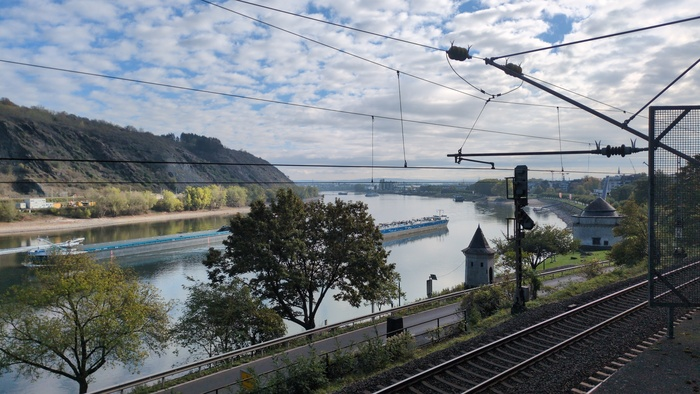
_There are trains and boats_

Eventually the sun came out and I was able to remove my gloves and neck-gaiter
and helmet and enjoy it.

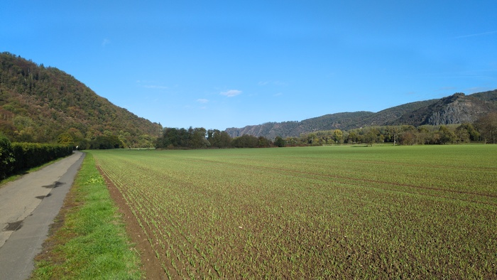
_Blue_

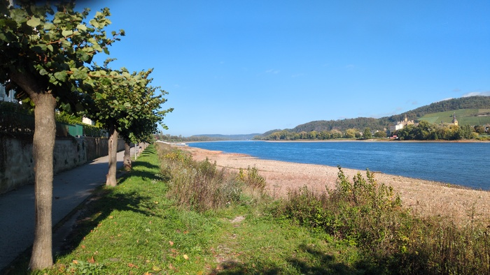
_The River is Wide_

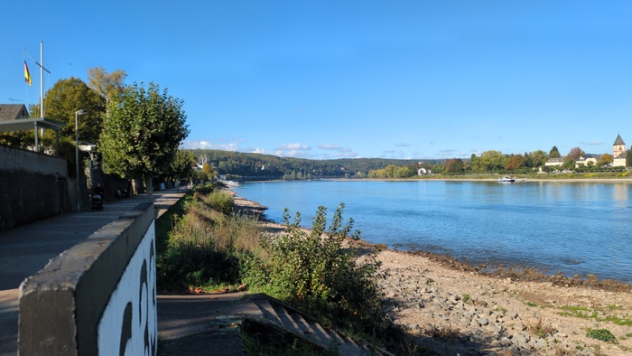
_River_

My phone ran out of battery unexpectedly and for the next hour or more it was
wired to the charger making it difficult to take photos.

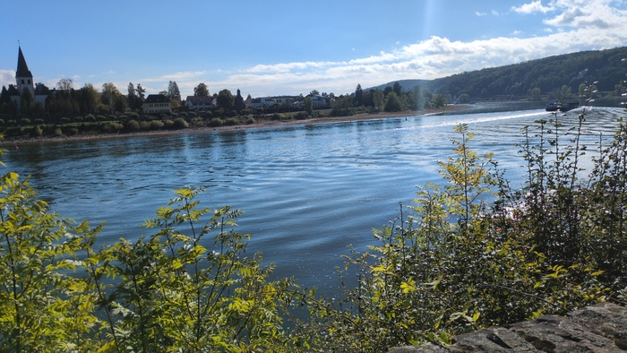
_Tethered photo_

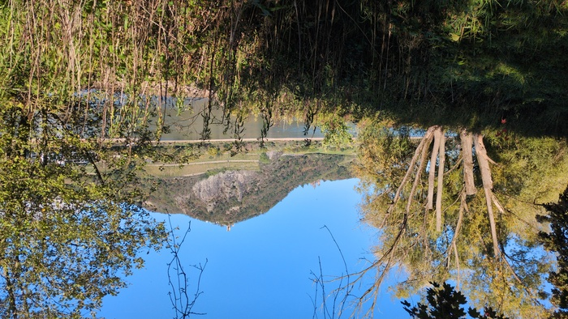
_Castle!_

There were castles but signficantly fewer than yesterday.

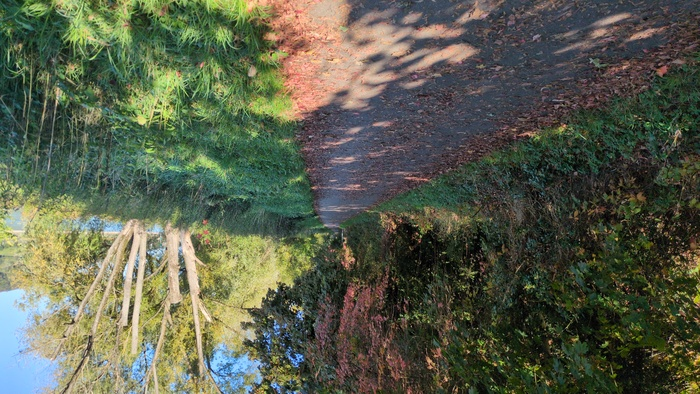
_Autumn leaves_

I made it to the city of Bonn. Which has a famous university and perhaps some
other famous things. I tried to investigate but the traffic was insane and I
got confused and left - passing the Beethoven concert hall on the way out.

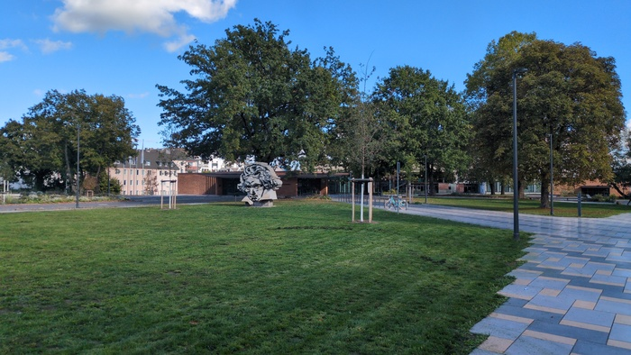
_Beethoven_

No accomodation was booked. I had the choice of Cologne or Dusseldorf. Cologne
would be a short day but it's an interesting city and Dusseldorf would just
about meet the standard 100-mile distance target of this trip. A short day
would give me some time to catch-up on work, but a longer day would mean
potentially getting back to my office faster.

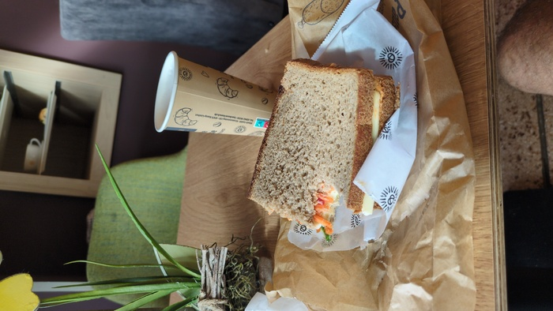
_This was the only food in 94 miles - I had reserves_

Smoking is still very-much a thing in Germany - it almost seems odd to see
people lighting up all over the place.

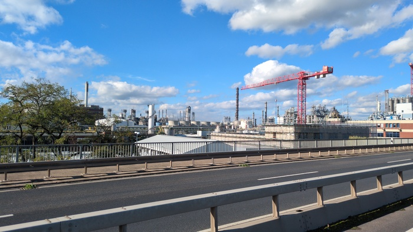
_There were chemical factories_

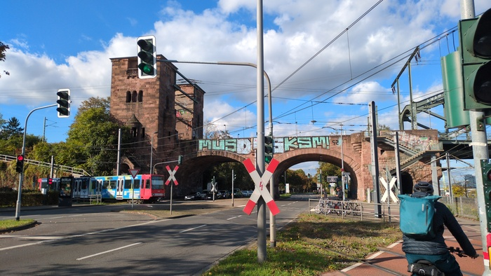
_Entering Cologne_

I made a point of visiting the cathedral in Cologne. Its simply an amazing
structure and (according to wikipedia) the most visited tourist attraction in
Germany. Construction started in 1248, was halted around 1560 and was
restarted in 1814 and completed in 1880. A massive medieval crane was
apparently left on top of the building for 400 years during the prolonged
delay. It somehow survived World War II.

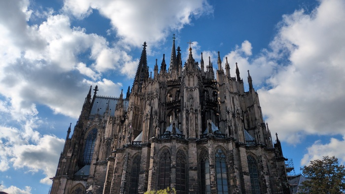
_Cathedral_

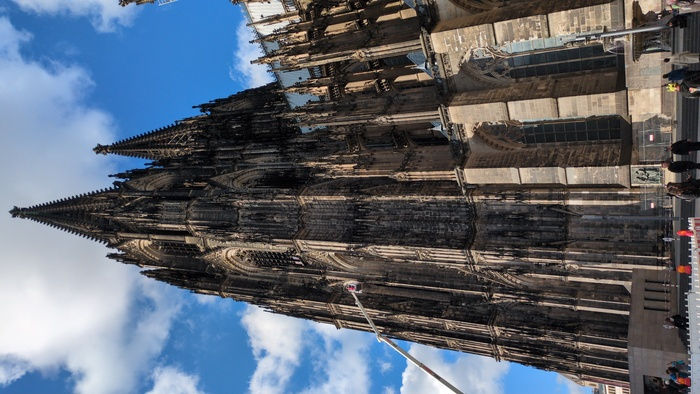
_Cathedral_

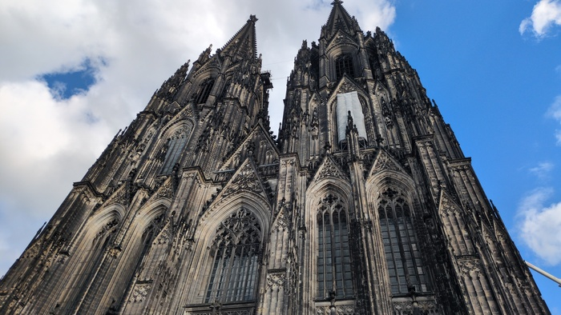
_Cathedral_

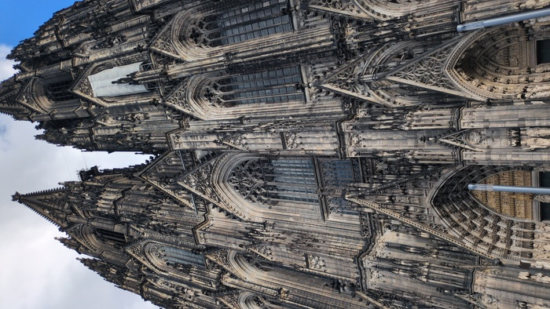
_Cathedral_

There is lots of shipping on the Rhine.

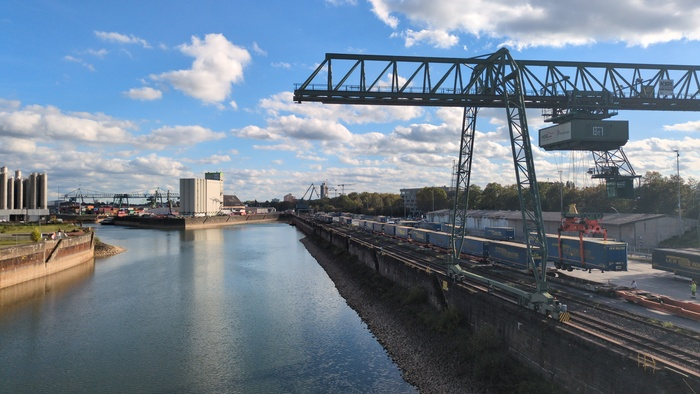
_Docks_

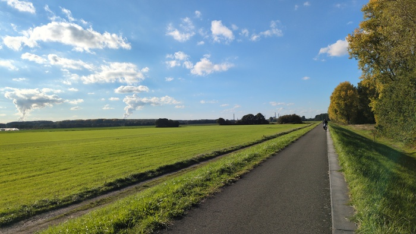
_And flat places_

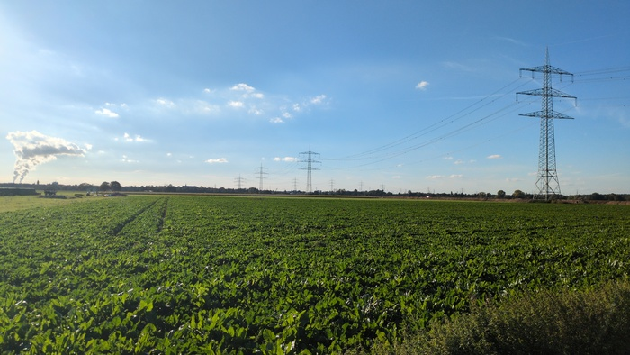
_Electricity too_

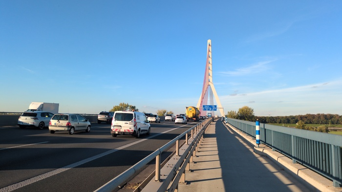
_Crossing the river to Dusseldorf_

The hotel manager suggested I leave my bike downstairs when I asked if I could
put it in the room "but of course!". It seems the answer to the question is
either an incontrovertable "no" or an "obviously you can - as long as you can carry it up the
stairs".

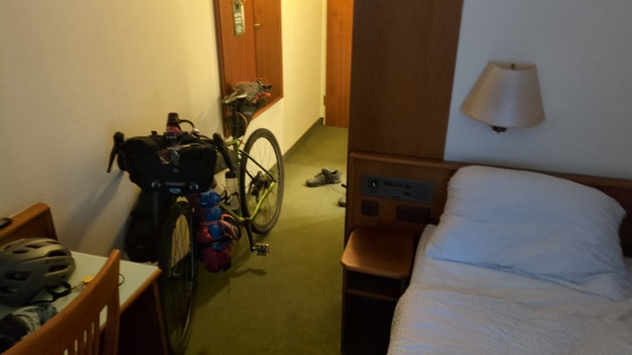
_Bike in room_

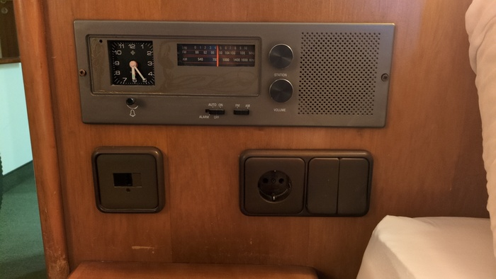
_Bedside radio (non-functioning)_

Tonight would be a take-away dinner. I ordered a pizza from a near-by
pizzeria. It would take 10 minutes so I went to Aldi-Sud[^firsttime] and got
some beers and went back and waited 5 minutes for the pizza and it was
presented to me "carte bitte" said I (I'll pay with card thanks) "nur bar" (only cash) "oder liafnaorna"
"eh?" "lifrenaan" "eh??" "liefando" i could also pay via. the Liefarando
delivery app but I couldn't so I had to go back to the hotel and find my
emergency €10 note. I now have no cash and that's the only cash I've spent so
far.

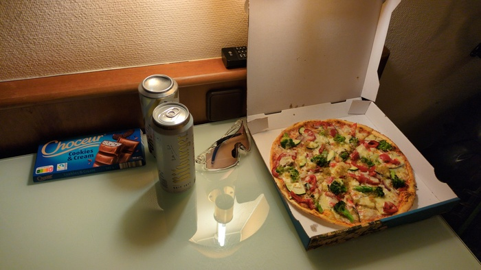
_Dinner_

Today has been generally dull. Cycling on the flat. Doing Italian lessons.
Listening to music. Smiling at strangers. The chocolate was good.

[^itseems]: the clock read 18:25 when I arrived, which happened to be within 3
minutes of the correct time so I gave it the benefit of the doubt, but no.
It's broken.
[^firsttime]: the first time I've been to Aldi-Sud which I wouldn't mention
    but that they were a client for 1.5 years.
