--- 
title: "Day 11: Eindhoven"
categories: [mannheim2026]
tour: [ mannheim2026 ]
distance: 118
time: 5h44m
gpx: /gpx/mannheim2026/eindhoven.gpx
#bundle_image: 202610112016-cathedral3.jpg
date: 2026-10-13
#fediverse: 117389960673430024
---

Slightly heavy eyes sitting hunched over a box-table with soft and classic
rock music playing in the background. I have a Duvel beer to my left and a
turtle swiming towards me on my right. The turtle is in a large tank. I'm not
sure why he's swiming towards me. I'm the only person in the hostel common
room save for the manager.

> I just walked away from the table to the other end of the room and when I
> approached the turtle was swimming towards my new direction. Is it trying to
> communicate? Is it angry?

I woke to the sound of rain. I wanted not that it rained nor did I expect it
to rain. The forcasst was sun. Today was a shorter day however. The ferry is
only 160 miles to the west-north and I had agreed to meet a friend for lunch
in Venlo which was 37 miles from where I was now sleeping.

The restaurant had no breakfast so I left the building into the rain and
crossed the square and crossed the tram-way to the bakery for coffee and
sandwich and choco-croissant an old man was refused a straw and was unable to
drink his coffee.

Went back to hotel and packed my stuff leaving into the spittling rain at
9:30am with some new music copied from laptop to phone.

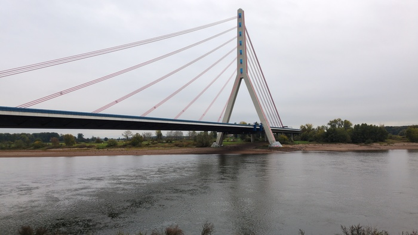
_Grey_

The music included Joy Division which was good accompaniment for the bad
weather and the bad weather permitted me to sing out loud "I've got the
spi-rit, but lose the fee-ling! I've got the spi-rit, but lose the
feel-ling"...

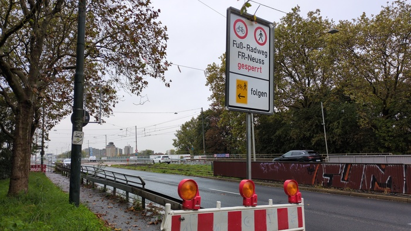
_The cycle path was open on the other side_

Various wildlife. More impressive herons, little black swiming birds, ducks,
swans and German power-walkers with their hiking poles and purposeful strides.

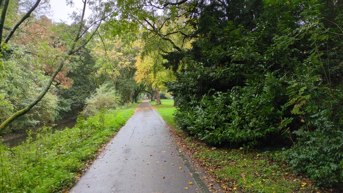
_Unseen Wildlife_

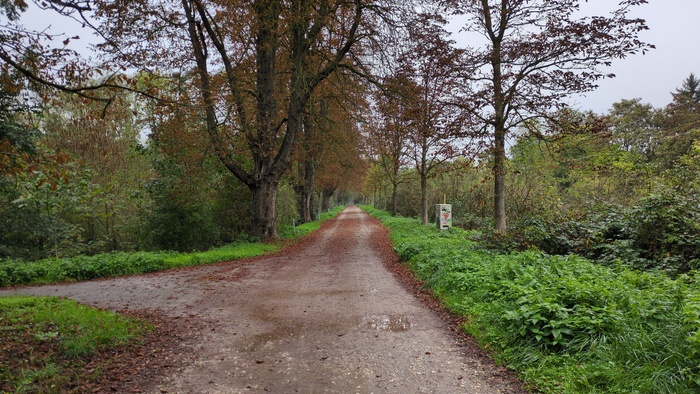
_There was a heron before this photo was taken_

Moist it was and my rear gears didn't seem to be changing properly and were grinding when
shifted up from the bottom. I became concerned that my gear cable had
stretched - which would mean it would break imminently - but recovered
it did, so perhaps it was just dirt and muck from the dirty and mucky day.

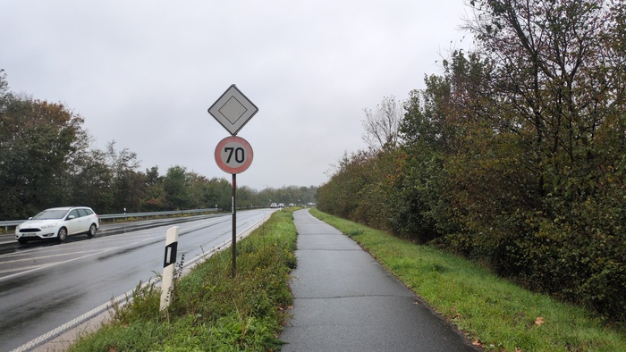
_Grim_

There was no descernible border crossing to the Netherlands on the forest
path. I went to meet my friend Tom in Velno for lunch. He organised that I
leave the bike at his father's home 5 minutes away and we ate what turned out
to be a very substantial and good meal and had a nice chat.

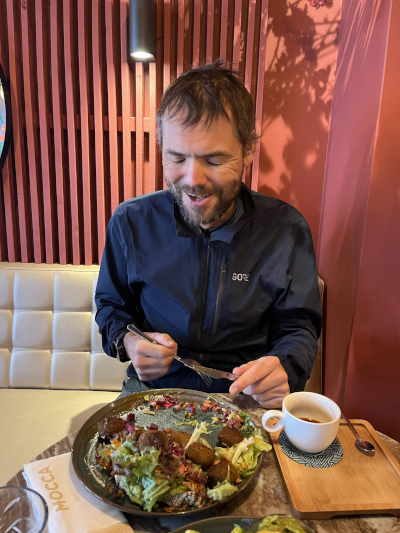
_Me with too much good food_

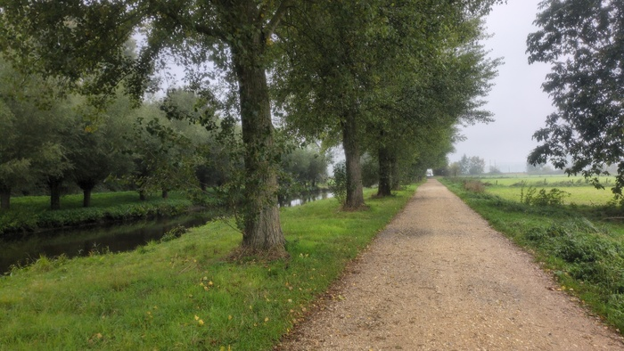
_Lots of this type of thing in Holland_

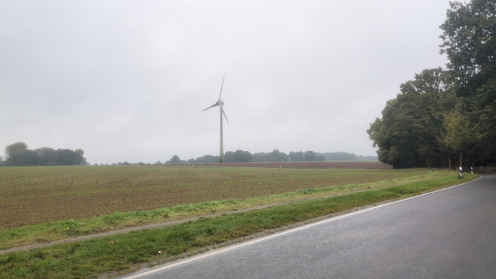
_Windmill 1_

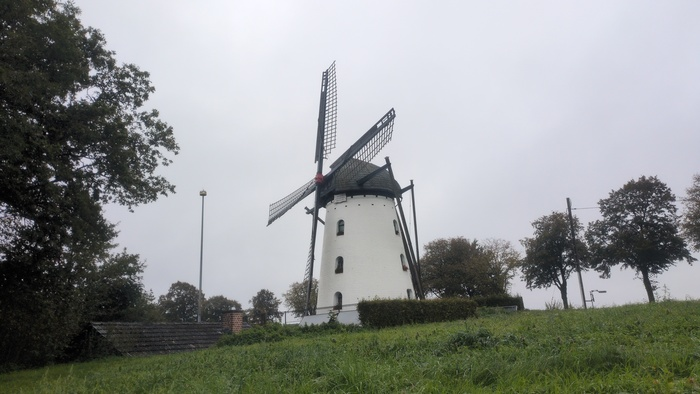
_Windmill 2_

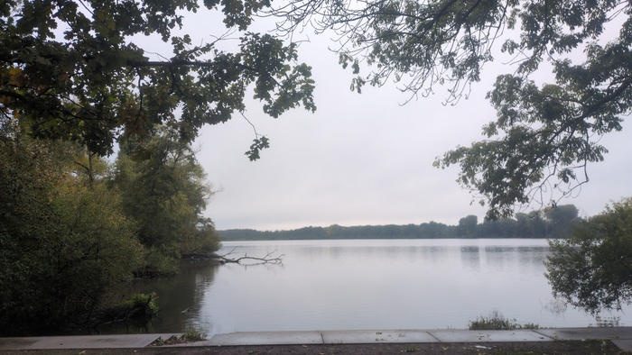
_Lake_

The sun made an appearance for an hour or so after lunch.

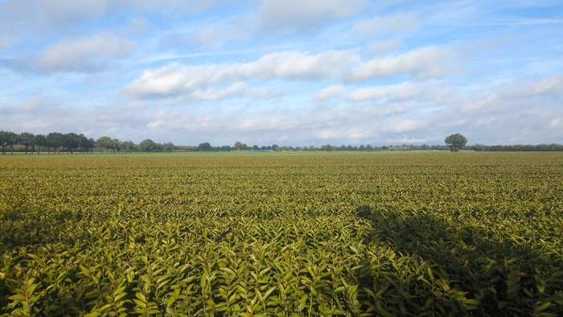
_Sun_

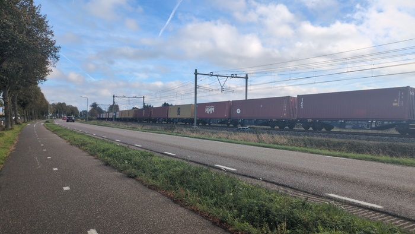
_Loads of carriages_

My bum was finally starting to give me some pain. Which is an impressive
record - almost 1000 miles without saddle-sore.

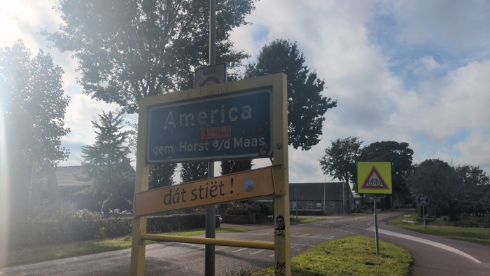
_Finding America_

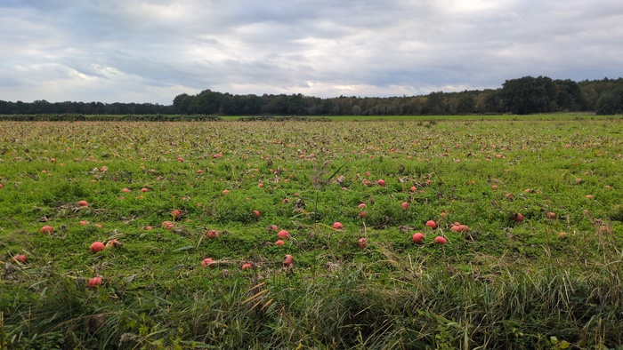
_Pumpkins_

The Dutch **don't wear bicycle helmets**, full-grown men and children ride
**no-handed**. Some rest their **elbows** on the **handlebars** in the triathlon position
with no tri-bars. A lady
rode **one handed holding her phone up without looking where she was going**. A
moped came at me on the **wrong side of the cycle path** and while I was shocked
he didn't flinch. Perfectly normal. In England I get shouted at by strangers
for doing any of those things. I like it here.

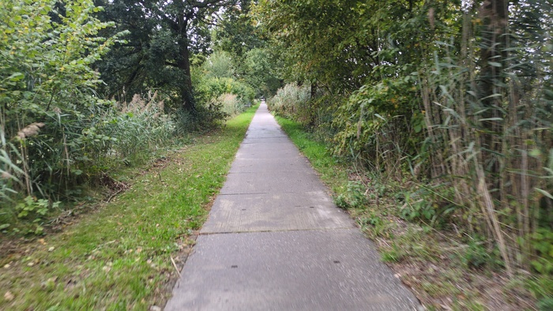
_Road to Eindhoven_

I wheeled my bike up and into the hotel. "Yees im shime" said the manager
"Sorry, English" I said "Joos im shtime" he repeated. I cogitated. "Ah! Just
in time!". I wondered to what he was referring it was two minutes to six. He
booked me in and provided me with a towel and a key for the locker (both of
which were billed as "extras"). I was indeed just-in-time because if I had
turned up 2 minutes later I would have been left out in the rain until 20:00
when the reception would re-open.

The hostel looks nice. The dorm beds are of the lowest grade however and there
is indeed black mould on the ceiling of the shower room if you care to look as
warned in a hostelworld review. I'm sharing the 8-bed dorm with a young guy from
Senegal. He is here looking for warehouse work after having worked in Italy in
a warehouse for ten years. "Where are you from?" he asked "Liverpool?
Manchester? I know these from the football" I showed him Weymouth on the
phone. "Where are _you_ from in Senegal?" I asked him "I have no idea" he said
and laughed - it was funny.

Due to the substantial lunch I wouldn't eat out - but made my way to the
supermarket passing through Eindhoven's beautiful city centre.

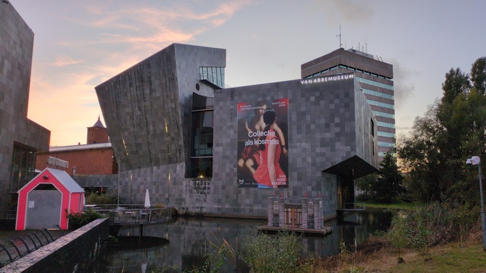
_Museum_

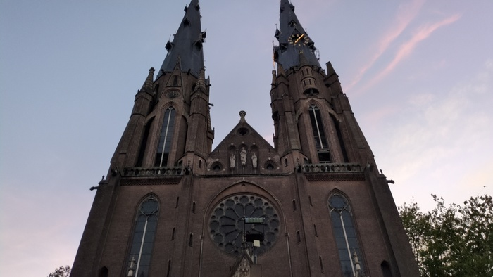
_Cathedral_

There is vibrant nightlife and more than a few English people and I found the
supermarket and thankfully they stock belgian beers and I got some pre-cooked
pasta to snack on. This would be a nice place to live.

> _oh I'd better book the ferry_. Ferry booked. I'M GOING TO HARWICH TOMORROW.

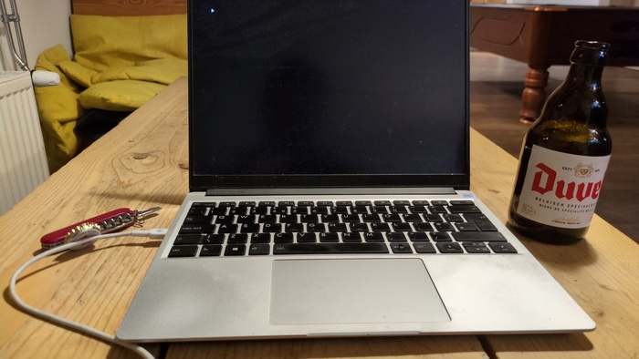
_Workstation_

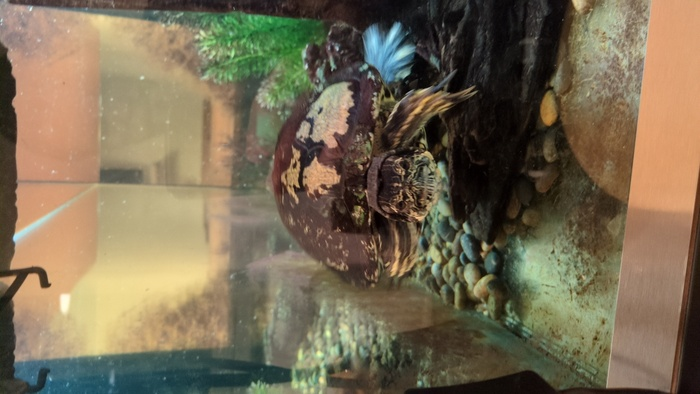
_The Turtle_
