--- 
title: "Day 12: Hook of Holland"
categories: [mannheim2026]
tour: [ mannheim2026 ]
distance: 146
time: 7h6m
gpx: /gpx/mannheim2026/hook.gpx
bundle_image: 202610131908-towers.jpg
date: 2026-10-14
#fediverse: 117389960673430024
---

I'm on the ferry. It's enormous yet there seem to be few passengers as of yet.
I arrived at the passenger terminal at 18:00 and they don't let you bring the
bike inside and there was a vending machine to give me calories but no cafe,
no shop. I had expected to wait 4 hours before boarding but I was able to
board at 19:00 with almost no waiting. I seem to be the only cyclist. I have a
cabin and have showered and am now typing this with a pizza and a beer which
was poured for me by a man with an unmistakably English accent.

I slept well in the low-grade dorm - there were just 3 of us and 4
double bunk-beds dorm and if anybody snored it was probably me. The manager
advertised breakfast as being available from 8:00. I suspect I was the only
"traveller" staying at the hostel however and he had not laid out the
breakfast. "Would you like coffee?" "yes" "ok, I will lay out the breakfast on
the table". He then proceeded to lay out a buffet - a bag of bread rolls, a
quantity of boiled eggs, cheeses and meats, apples and margerine and jam
sachets. I'm fairly sure this was all for my benefit.

I got changed into my cycling gear in the privacy of the bathroom toilet (as
there was no privacy in the dorm) and gathered my things from the locker and
handed the key and room-card back to the manager "Did you check that the
locker is empty?" I pictured the empty locker in my mind "Yes" "Good, I find all sorts.
Passports, IDs, phones". He mentioned the cyber attack on the Albert Hejn
supermarket yesterday and we shared a pessimistic attitude towards technology
and "AI". I thanked him and left stopping 10 minutes later to really be sure I
hadn't left my passport in the locker.

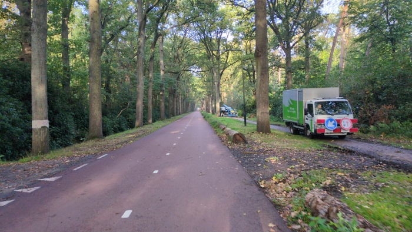
_Corridor of Trees_

The weather was good. 

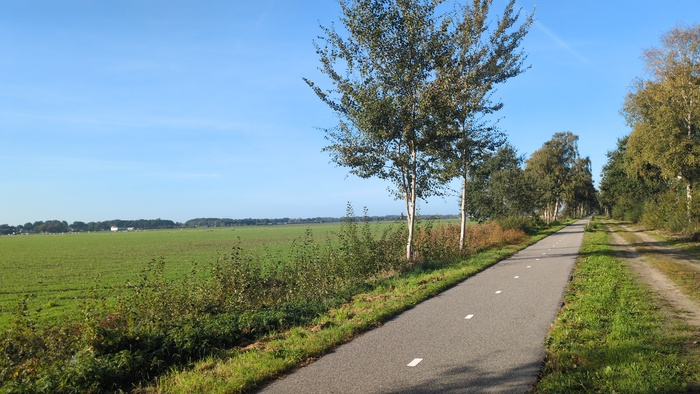
_Still flat_

But things were very much flat.

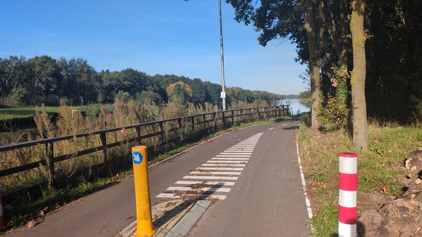
_Still cycle paths_

There were Geese.

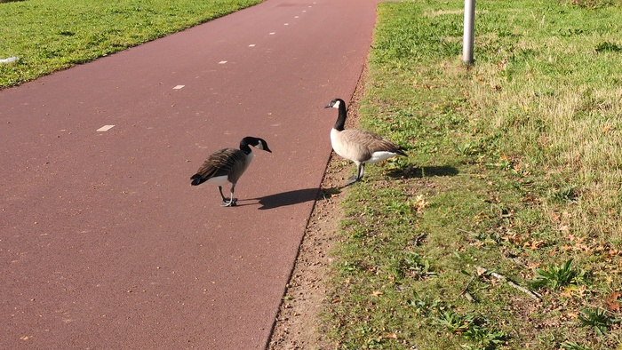
_Geese_

The canals reflected the sky but when you looked closer there was swirling
green patterns - which I'm guessing is Algae?

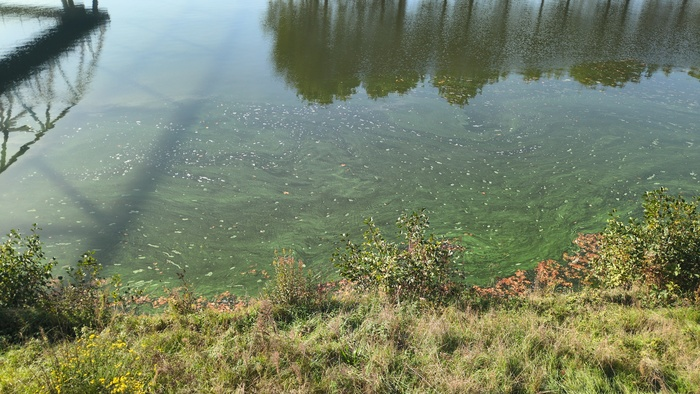
_Sludge_

There were cycle path closures involving improvised detours with the Garmin
trying to sabotage me by directing me back to the closed path. The Garmin Edge
cycle-computer is great when it works, but there are plenty of examples where
it either lacks or lets you down. There is no way to say "the road ahead is
closed - route around it" and I'm glad I can fall-back to [OSMAnd+]() on my
phone.

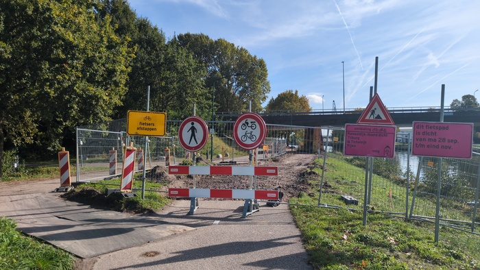
_Cycle path rennovations_

The route was unsurprisingly flat and almost exclusively on cycle paths. I was
over taken numerous times by the fat-kids[^fatkids] on fat-wheeled low-riding
electric bikes. It seems these bikes are a _thing_ for teenagers.
They either cruise at or have a top speed of around 15mph so I often end up
overtaking them again and then I feel compelled to maintain my advantage to
the detriment of my phsyical condition later in the day.

I became hungry, perhaps the various jam sandwhiches I had eaten for breakfast
lacked the nutritional fuel that the day required. The shop looked like it
sold cheese, but it also sold cakes and bread. The lady greeted me in Dutch
"hvae you got any sandwiches?" she showed me "cheese, tuna" "no tuna" "just
cheese then" "eggs?" "no" she laughed "no eggs we're not a restaurant - one
sandwich or two?". The
sandwich was packed ostentatiously in box and I thanked her and left the town
without finding an appopriate bench. 15 hungry minutes later I found an
appropriate seat and unwrapped my present: sandwich did actually have eggs and
it was delightful. I should've gotten two though.

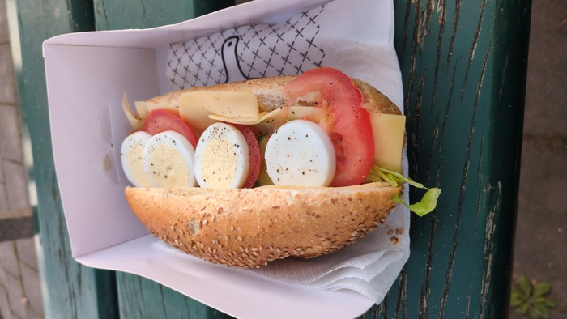
_Lunch_

The traffic-light ettiquette between Dutch and Germans is stark.

**Scenario**: there is a red light but there's no traffic. On the other side a mother and a
child are waiting on their bikes. Do you show a bad example by crossing when
the light is red?

- **German**: I will wait.
- **English**: Fuck 'em.
- **Dutch**: The mother and child already crossed on the red light.

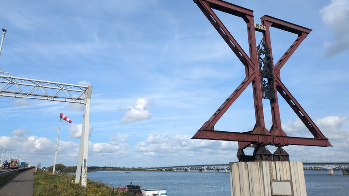
_1974_

I knew that I would have to wait at the ferry terminal so I tried to slow
down. I was overtaken by cyclist loaded with similar gear to me he said
"hello" and rode ahead but it was clear that I was going to awkwardly overtake
him again "where you heading?" I said as I pulled up "blah blah, accent, blah
blah, French (?)" "non, je suis anglais, mais je parle un peu Francais" I'm
not sure if he assumed **I** was French or said that **he** was French either
way he was riding to Rotterdam _tomorrow_ and getting the train to Brussels.

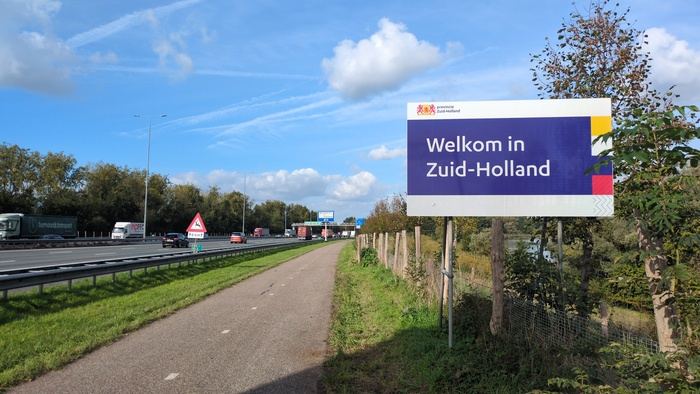
_South Holland_

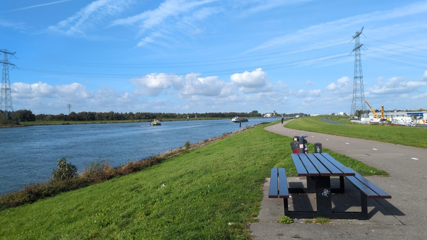
_Neiuwe Merwede_

Some of the cycle crossings had a "waiting" indicator provided a countdown to
when the light would go green. I liked that.

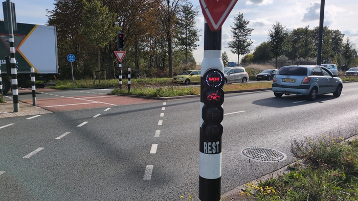
_Countdown to Green_

As I rode into Rotterdam the local traffic became more intense both on the
road and on the cycle paths. There were more electric bikes than not and the
paths were shared with mopeds and other single-person vehicles[^caddies]. It was a
little crazy and I tried to keep my wits about me as I had no medical
insurance[^medical].

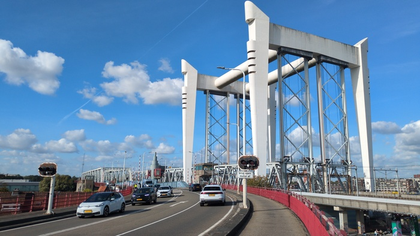
_Didn't really figure out how this lifting bridge in Rotterdam worked_

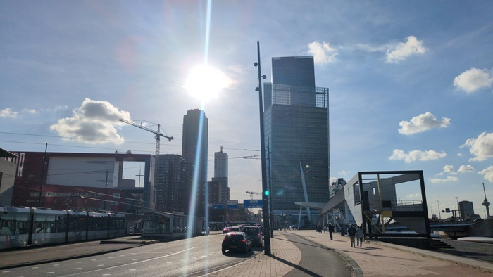
_Towers_

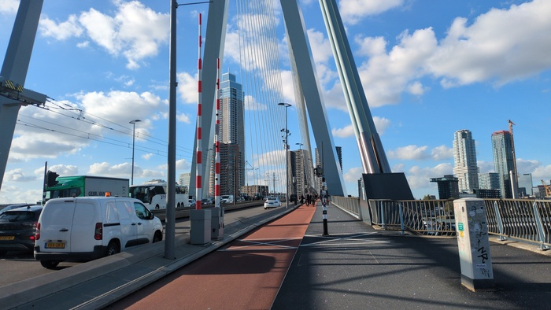
_Crossing the Nieuwe Mass river in Rotterdam_

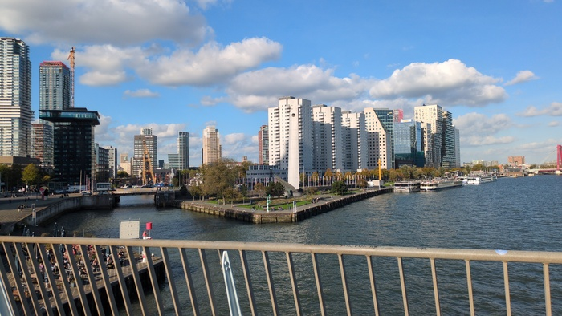
_View from the same_

Rotterdam was impressive and busy and it was just 22k to the Hook of Holland
and the terminal and I rode up the river Scheur to meet it.

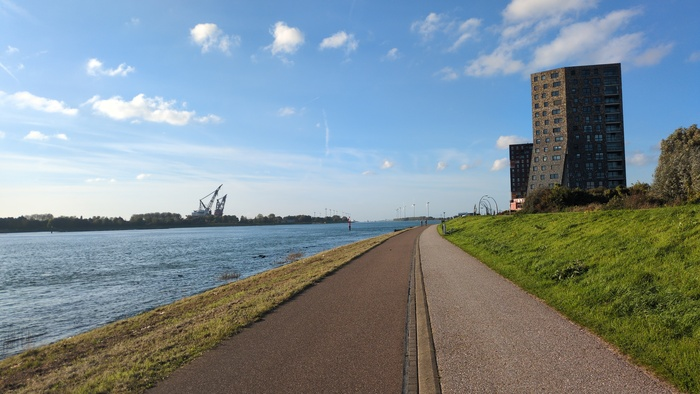
_The Scheur_

I passeed the [Maeslantkering](https://en.wikipedia.org/wiki/Maeslantkering).
A epic "storm gate" that closes automatically when a computer predicts a
storm-surge. It's one of the largest moving structures on the planet according
to Wikipedia. The gates are automatically closed by computer when certain
conditions are met. Those conditions are expected to be met once in every **10
years** (but it is tested manually once a year).

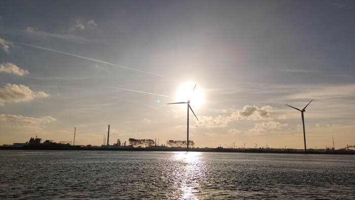
_Windmills_

I was feeling exhausted. I had bonked. I was looking forward to getting to the
ferry terminal to have a coffee and a cake. There would be no cake.

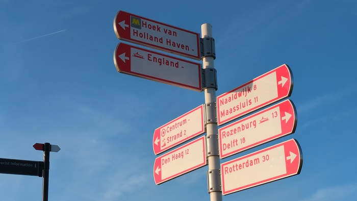
_This way for Engel Land_

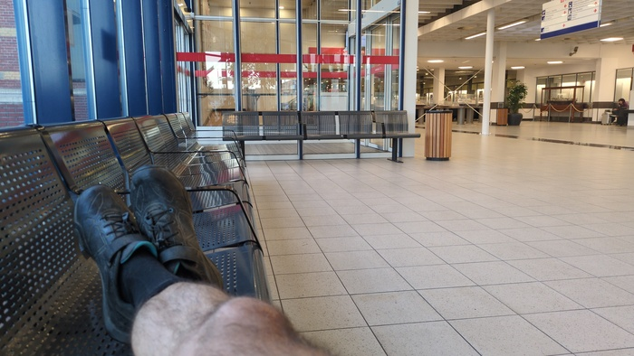
_No cake. Just biscuits._

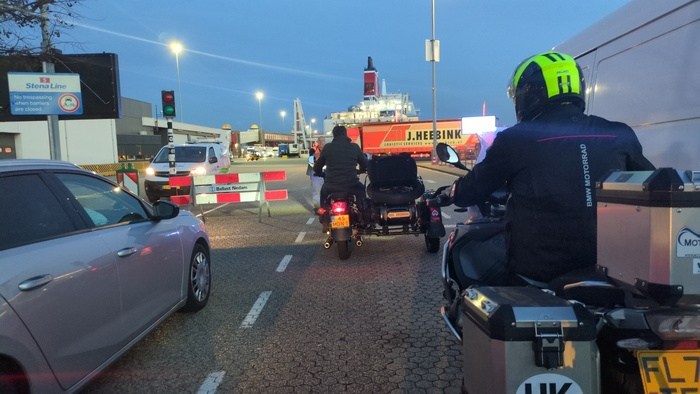
_Just us_

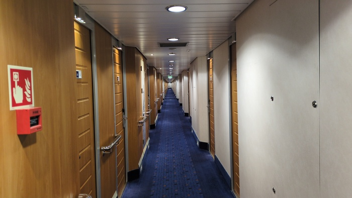
_The Corridor_

This is possibly the last post, if so the whole trip was 1002 miles (1614km)
with an average of 86 miles a day (95 miles a day if you exclude the unusually short
ride to Mannheim). There were no rest days other than the conference. I'm
pretty exhausted. Tomorrow I'll see how far I can get with the train and aim
to be back home by late afternoon.

[^fatkids]: that's very unfair of me.
[^medical]: forgot to get the insurance prior to leaving...
[^caddies]: namely strange golf-caddy type vehicles and the occasional person
    in an electronic wheel-chair.
