Sitting conspicuously on a 4 seated table in a traditional German restaurant
in the woods typing on my laptop. My headache is active - the still hanging
hangover from two nights previous - not that I drank an extreme amount but the
conference the day after pushed my headache over the edge.

> Very much struggling with my German and probably my English too and I
> somehow manage to switch to French. I'm probably very tired and my brain is
> has just not realised it yet. "Salad Bar" "Folgen sie mir" "Salad Bar". "Du"
> "Salad Bar" "Bitte". I was shown the salad bar. There are little flies flying around
> in front of me and I'm not sure if I bought them with me.

This morning I went down for breakfast. As usual I had to orientate myself as
to what was available and where it was located. Coffee, juice, breads -
where's the butter? - cerals, youghurts. Do they have trays? Nope - find a
table - start transporting food to it. The staff were warm and
friendly and everybody I've interacted with in this neighbourhood have been
likewise. 

_Before breakfast_ I woke up. _Before I woke up_ I was dreaming of
cycling. I'd cycle down a hill and then be thrown up, accelerating, into the
air and I'd look down and the ground would be further and further away and I'd
have further and further to fall and the vertiginous, dooming, knowledge that
the higher you get the harder the landing will be and fall and bounce and then
be thrown even higher.

I had left my keycard in the room and I got a new keycard and packed my bike up and
carried it down the two flights of stairs gave the keycards back to the
receptionist and thanked me and I had to prompt her "Ich muss fur das Frustuck
Bitzahlen". I had already booked a place opposite Koblenz train station for
£34. It was 94 miles away and the route would take me up the Rhein river and
infact the entire route to the ferry looks like it follows the Rhein.

>  Yesterday I did the conference and it was good fun. It would've been better
>  if I didn't have a hangover which kicked in at around 11am and was more
>  debilitating _after_ I gave a 50m talk. Saw old friends and made new ones.
>  This photo is Stephan conducting the session planning:
>  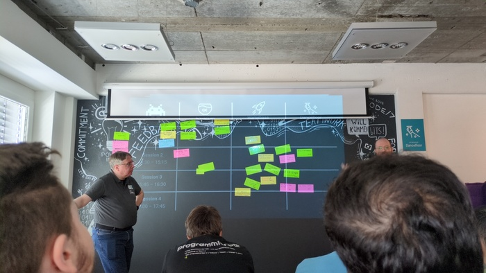

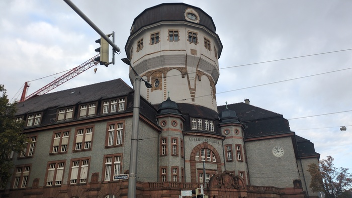
_Pulling out of Mannheim_

I left Mannheim with the traces of a headache. The bumps in the road and the
grinding of my chain which needed oiling after the downpour 2 days
previously. I crossed the Rhein over the [Theodore-Heuss
Bridge](https://en.wikipedia.org/wiki/Theodor_Heuss_Bridge_(Mainz-Wiesbaden))
which required me to carry my bike up some church-like steps.

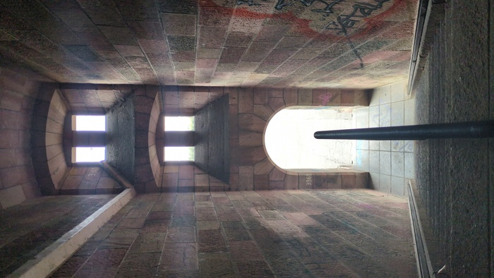
_Steps_

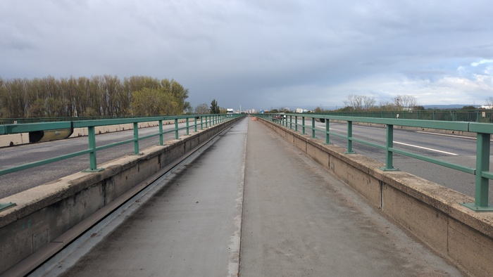
_Theodore-Heuss Bridge_

I saw a Heron and then I was in Worms. Wikipedia says that Worms is where
[Martin Luther was ex-communicated](https://en.wikipedia.org/wiki/Martin_Luther).

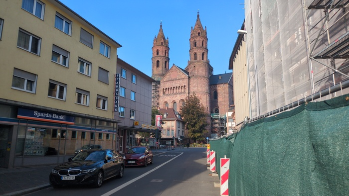
_Worms_

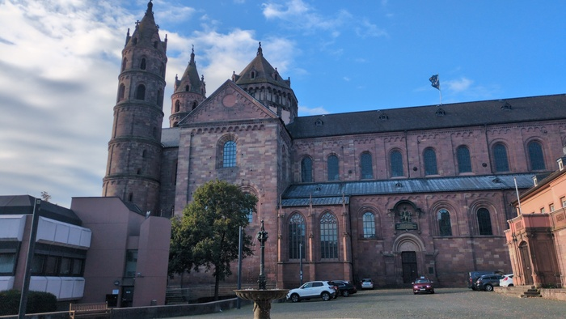
_Worms_

It was Sunday and it was 10:30am. Shops are typically closed on Sunday and I
couldn't guarantee that I'd find anything for lunch so I decided to buy some
food as soon-as-possible. I used Google maps to search for bakeries that were
open and when I got to the open bakery it closed because it
was 11:00 so I went back to a garage passed one minute before and purchased
three chocolate bars as an insurance policy should I not find anything else.

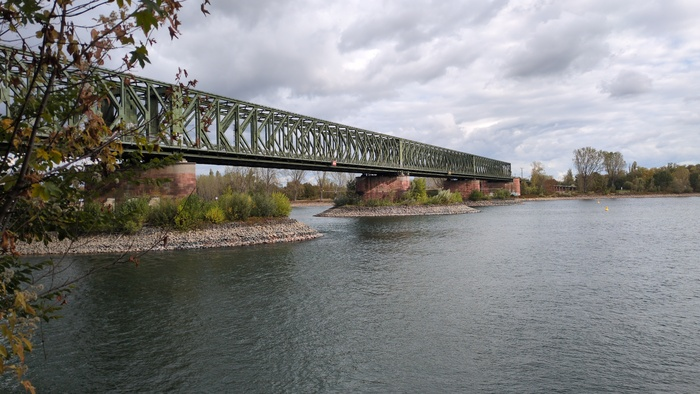
_Eisenbahn Bridge_

The route today would cover two parts of the Rhine:

- [Upper Rhine](https://en.wikipedia.org/wiki/Upper_Rhine_Plain): Riding North to Mainz and West to Bingen on the 
- [Middle Rhine](https://en.wikipedia.org/wiki/Middle_Rhine): Riding North West to Koblenz on the.

Riding to Mainz involved riding overland to an altitude of around 280m at
which point the dark clouds that had been brewing turned into water and I
descended towards the city which would have left a better impression in better
weather.

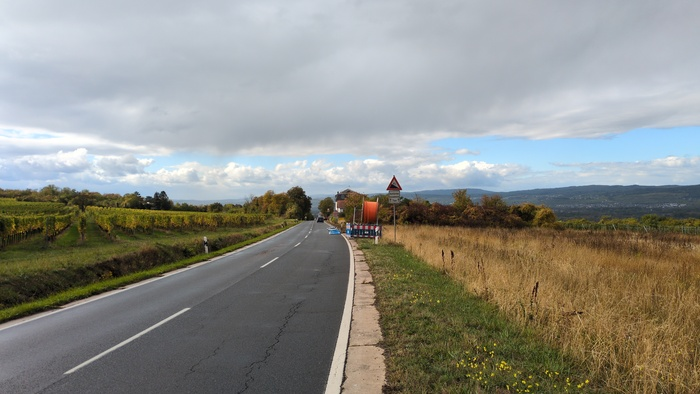
_Downhill and wet from here_

There were plenty of places to get good food in Mainz on Sunday but I had
already purchased a shitty sandwich from a petrol station so shitty sandwich
and chocolate bar was my lunch sitting on a shitty bench in the colding rain.

Onwards riding and clouds darkened and gusts blew leaves from the trees. Some
stuck to me and I grabbed them away and the rain started again and I sheltred
in the shelter of a petrol station until the intensity lessened.

The cycle path west was marked with the cycling symbol and **Pendler** written
directly below it. Pendler apparently means "Commuter" in German. As I wasn't
commuting I wondered if I was on the right cycle path.

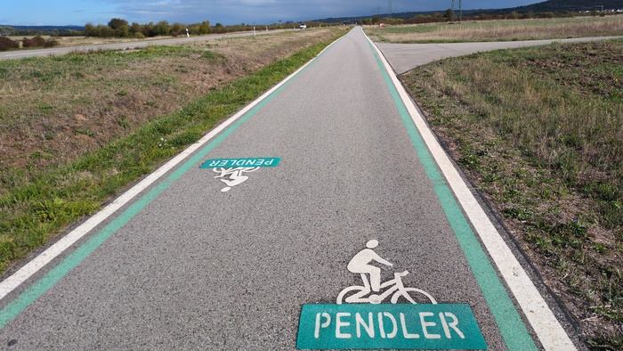
_Commuter_

Bingen was the somehow un-German sounding town that marked the start of a 33
miles riding directly alongside the hill-enclosed and castled Rhine on cycle paths on the Middle Rhein
section which according to
[Wikipedia](https://en.wikipedia.org/wiki/Middle_Rhine) _"is considered the
epitome of the Rhine romanticism. It inspired Heinrich Heine to write his
famous poem 'Lorelei' and Richard Wagner to write his opera
Götterdämmerung"._

It was a wonderful ride and the weather mostly held as I passed the vine-yards
on the hills and the massive freight barges and there seemed to be a castle on
every single turn of frequently turning river.

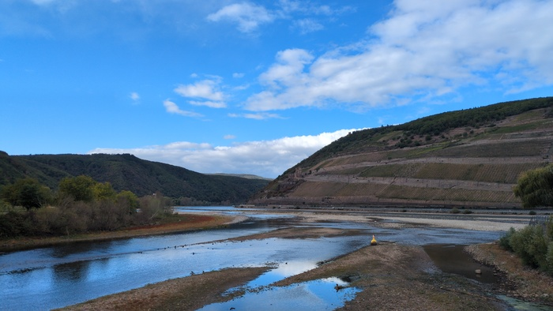
_Turning a corner_

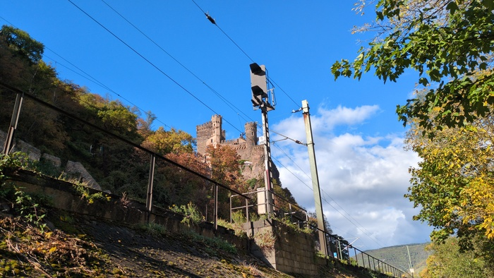
_Castle Rheinstein_

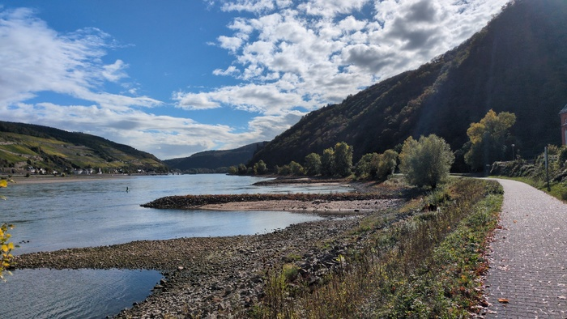
_River_

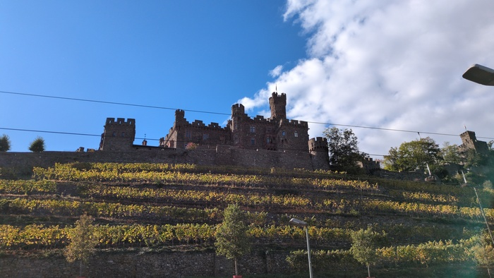
_Castle_

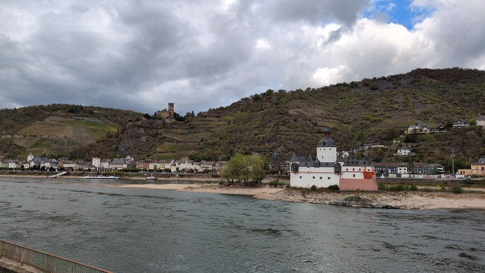
_Castle_

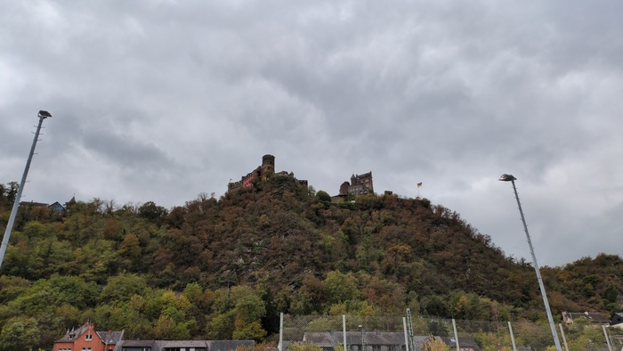
_Castle_

I stopped for a coffee and a cake and sat down in the rain to consume them and
left but sunglasses were left on the bench so I came back.

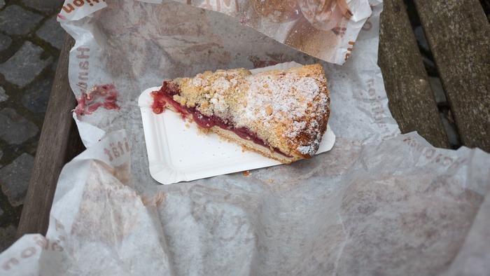
_Cake_

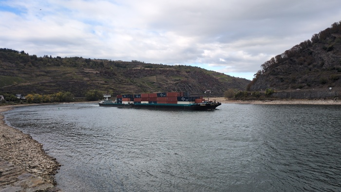
_River with Cargo Barge_

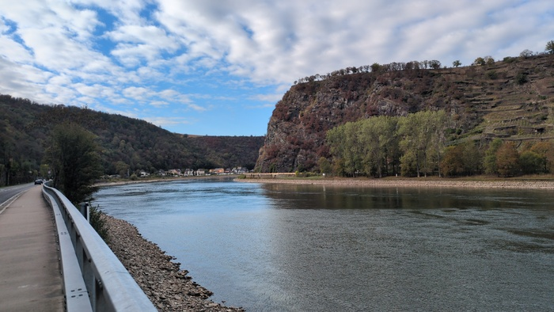
_River_

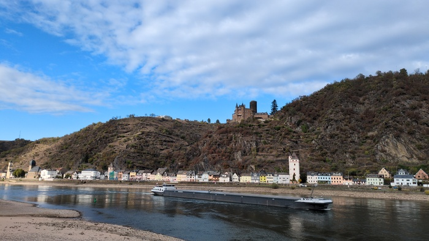
_Castle_

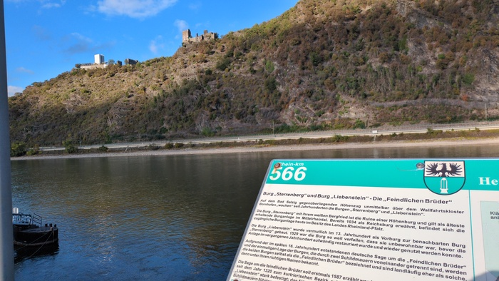
_Castles_

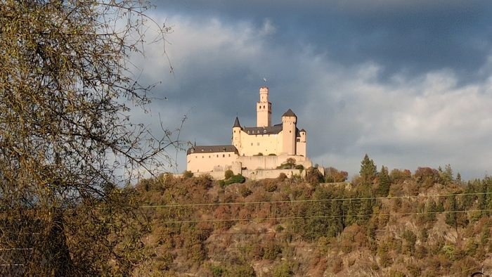
_Big Castle_

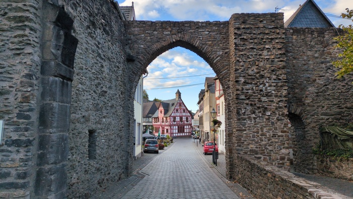
_Not a castle_

I didn't take photos of all the castles. There really are quite a number of
them. I was heading towards Koblenz. Earlier in the day I had received an
email from booking.com explaining that the was a problem with my booking and
they would refund it. So I had to get a new hotel - I selected one which I
thought I recognized from earlier in the day - a hotel - on the otherside of
the river - maybe about 1k from Koblenz. The hotel was not the one I had
intended to pick.

The hotel was 10k further in the wrong direction - what's more it was
isolated and 180m higher than I currently was.

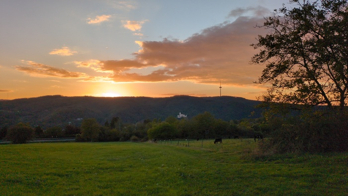
_Sunset as I climbed_

"I have a bicycle" I struggled in German "blah blah blah turn right go
straight ahead there is a deep-garage" "can I put the bike in the room?" "no".
The deep garage was large there was a tiny bike stand to which I lcoked the
bike and ascended to room 701 on the 7th floor and, I had paid £30 for this
room and it was actually nice and has a balcony with a partially amazing
view. I could live here.

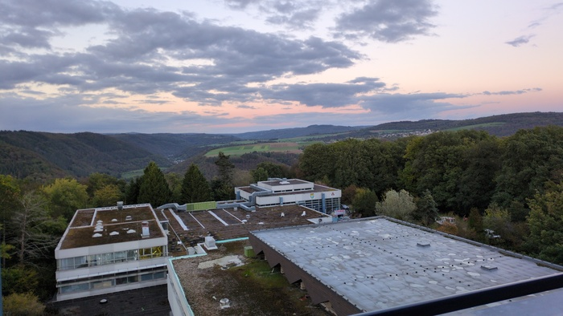

The restaurant was closed but there was a German restaurant just accross the
road and I had a traditional German (vegetable) Schnitzel with chips and a
what (I like to believe was) an all-you-can-eat _Salad Bar_

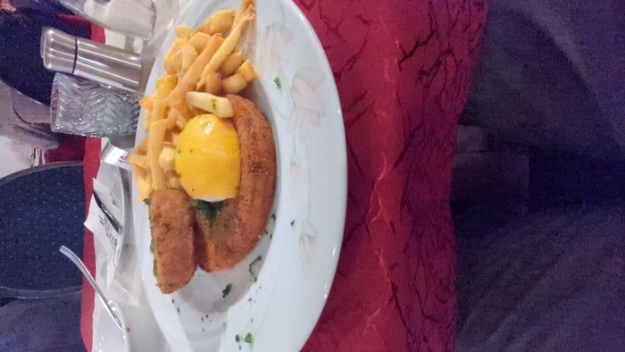
_Vegetarian Schnitzel_
